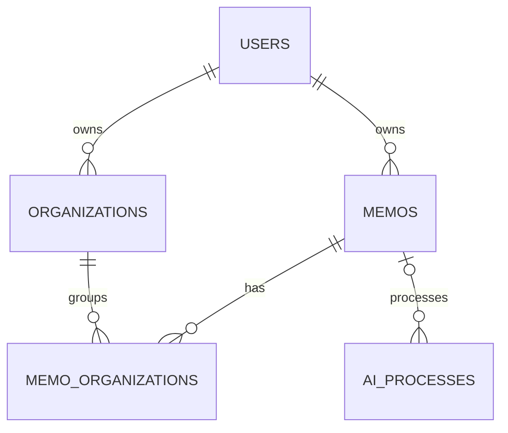
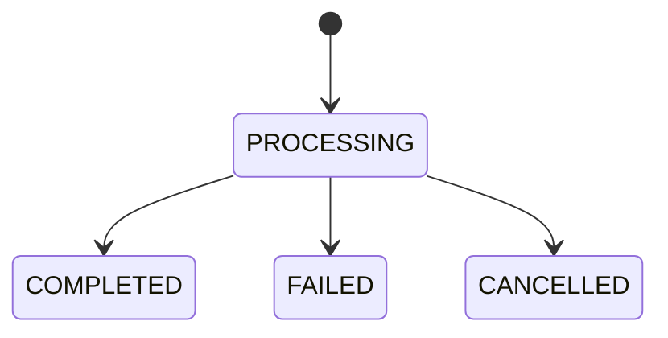

# Phase 5 DB基本設計

## 1. 文書の目的

本書は、「放り込むだけAI整理ツール」のMVPで使用するデータ構造、テーブル間の関係、主要な制約およびデータ整合性ルールを定義する。

本書で定義した論理構造をPhase 6「詳細設計」の入力とする。DB製品に依存する具体的な型、DDL、インデックス名などは、確定済みの制約を維持したうえでPhase 6以降に具体化する。

## 2. 設計方針

- ユーザーごとにメモと整理構造を分離する。
- メモ原文とAIの整理結果を分離して保持する。
- 1件のメモを複数のorganizationへ関連付けられるようにする。
- organizationは親子関係を持つ階層構造とする。
- AIの初回提案、現在の確定状態、未確定の再整理提案を区別する。
- 未確定の再整理提案は確定データと分離し、`ai_processes.proposed_result`に保持する。
- AI処理は実行単位で履歴を保持する。
- AI処理中でもメモを削除でき、完了後の結果は反映しない。

## 3. ER概要



`organizations`は同一テーブルの`parent_id`によって自己参照し、ツリー構造を表現する。

## 4. テーブル一覧

| テーブル | 役割 |
|---|---|
| `users` | 利用者と認証に必要な情報を保持する |
| `memos` | タイトルと原文を含むメモ本体を保持する |
| `organizations` | ユーザーごとの階層型整理構造を保持する |
| `memo_organizations` | メモとorganizationの関連および関連種別を保持する |
| `ai_processes` | AI整理・再整理の実行履歴、状態、および未確定の再整理提案を保持する |

## 5. テーブル定義

### 5.1 `users`

| 論理項目 | カラム | 必須 | 説明 |
|---|---|---:|---|
| ユーザーID | `id` | Yes | 主キー |
| メールアドレス | `email` | Yes | ログイン識別子。ユーザー間で重複不可 |
| パスワードハッシュ | `password_hash` | Yes | 平文パスワードは保存しない |
| 作成日時 | `created_at` | Yes | レコード作成日時 |
| 更新日時 | `updated_at` | Yes | レコード更新日時 |

認証要件は次のとおり。

- パスワードは8文字以上64文字以下とする。
- スペースだけの入力は認めない。
- 英字・数字・記号の組み合わせは強制しない。
- 登録・ログイン時のメールアドレスは、前後空白除去後に `toLowerCase(Locale.ROOT)` で小文字化して保存・検索する。DBの`UNIQUE(email)`は維持し、小文字CHECKは追加しない。DBへの直接書込では大小文字違いの重複を防げない（MVPの既知制約）。
- 認証方式はSession＋Cookieとする。Phase 8 Wave 0-Aにおいて、MVPの単一Spring BootインスタンスではSessionをアプリケーションメモリに保存する方針を確定した。共有Sessionは将来のスケールアウト時に再検討する。

### 5.2 `memos`

| 論理項目 | カラム | 必須 | 説明 |
|---|---|---:|---|
| メモID | `id` | Yes | 主キー |
| 所有ユーザーID | `user_id` | Yes | `users.id`への外部キー |
| タイトル | `title` | Yes | ユーザー編集またはAI自動生成による表示名 |
| 原文 | `content` | Yes | ユーザーが保存した本文。空白・改行のみは不可 |
| 原文更新日時 | `content_updated_at` | Yes | 原文の最終更新日時。タイトルのみの更新では変更しない |
| 作成日時 | `created_at` | Yes | レコード作成日時 |
| 更新日時 | `updated_at` | Yes | レコード更新日時 |

主要ルール：

- AI整理より先にメモを保存する。
- AI整理に失敗してもメモ原文は保持する。
- AI処理中もタイトル・原文を編集できる。更新時はmemo悲観ロックを取得し、競合時は409とする。
- AI処理中に原文が変更されても、返却済み／返却予定のAI結果はMVPでは自動無効化しない。
- 原文変更時は `content_updated_at` を更新する。タイトルのみの更新では更新しない。
- 原文変更後も既存の整理結果は自動削除しない。outdated判定は `content_updated_at` と「その整理結果が参照した本文の基準時刻」を比較する。
  - 未判断REORGANIZE提案：対応する `ai_processes.created_at` を基準とする（`proposed_at` はFIFO専用で、outdated判定には使用しない）。
  - AI由来CURRENT（INITIAL由来、またはREORGANIZE提案をそのまま採用）：CURRENT行の `ai_process_id` で対応する `ai_processes.created_at` を基準とする。
  - 手動CURRENT（通常変更、「変更して使う」）：`ai_process_id = NULL` とし、CURRENT行の `created_at` を確定時刻として基準にする。
  - 手動CURRENTの確定時刻は上記CURRENT行の `created_at` を採用する。DB時刻源とJPA採番経路は§10.1に従う。

### 5.3 `organizations`

| 論理項目 | カラム | 必須 | 説明 |
|---|---|---:|---|
| organization ID | `id` | Yes | 主キー |
| 所有ユーザーID | `user_id` | Yes | `users.id`への外部キー |
| 親organization ID | `parent_id` | No | `organizations.id`への自己参照外部キー。ルートはNULL |
| 名称 | `name` | Yes | 画面に表示する整理項目名 |
| 正規化名称 | `normalized_name` | Yes | 同名重複判定用。MVPでは前後空白除去＋小文字化 |
| 作成日時 | `created_at` | Yes | レコード作成日時 |
| 更新日時 | `updated_at` | Yes | レコード更新日時 |

主要ルール：

- 未確定のAI再整理提案のみを理由としてorganizationを作成しない。再整理提案で新しいorganizationが提示された場合、ユーザーが採用または変更して使用することを確定した時点で作成する。
- 親子は同一ユーザーに属さなければならない。Phase 8 Wave 1ではServiceによる所有者検証に加え、`UNIQUE(id, user_id)` と `(parent_id, user_id)` → `organizations(id, user_id)` の複合FKでも検証する。
- `normalized_name` は名称の前後空白を除去して小文字化した値とする。Java実装では `toLowerCase(Locale.ROOT)` を使用し、全角半角等の追加正規化はMVP対象外。
- 同一ユーザー・同一親配下では `normalized_name` が同じorganizationを禁止する。
- ルートorganizationは `parent_id = NULL` のままとし、子階層も含めてPostgreSQL 17の単一制約 `UNIQUE NULLS NOT DISTINCT (user_id, parent_id, normalized_name)` で同一ユーザー・同一親配下の重複を禁止する。ルート専用の別制約は設けない。
- organizationを複数新規作成する場合は親→子、同一階層では `normalized_name ASC` の決定的な順序で作成する。
- 自分自身および自分の子孫を移動先に指定できない。
- 子organizationまたは削除を妨げる関連が残っている場合は削除できない。`AI_SUGGESTED`参照も削除を妨げる関連に含める。APIは409を返し、UIでは理由と関連メモを表示する。
- 外部キーの削除動作は`RESTRICT`を基本とし、削除可能性は業務ロジックでも検証する。

### 5.4 `memo_organizations`

| 論理項目 | カラム | 必須 | 説明 |
|---|---|---:|---|
| 関連ID | `id` | Yes | 独立主キー。`memo_organizations_id_seq`で採番 |
| メモID | `memo_id` | Yes | `memos.id`への外部キー。`ON DELETE CASCADE` |
| organization ID | `organization_id` | Yes | `organizations.id`への外部キー |
| 関連種別 | `relation_type` | Yes | `AI_SUGGESTED`、`CURRENT`のいずれか |
| AI処理ID | `ai_process_id` | 条件付き | `AI_SUGGESTED`は元INITIALを設定。`CURRENT`はAI由来（INITIAL由来／REORGANIZE提案をそのまま採用）の場合に元AI処理IDを設定し、通常の手動変更／「変更して使う」ではNULLとする |
| 作成日時 | `created_at` | Yes | レコード作成日時 |

`CURRENT` の `created_at` は、`ai_process_id = NULL` の手動確定CURRENTではoutdated判定の確定時刻として使用する。

主な制約：

- `id`を独立主キーとし、`(memo_id, organization_id, relation_type)`を業務上の複合ユニークとする。
- memo削除時は `ON DELETE CASCADE` により関連する `memo_organizations` を削除し、孤立レコードを残さない。
- メモとorganizationは同一ユーザーに属さなければならない。

#### 関連種別

| 種別 | 意味 | 更新方針 |
|---|---|---|
| `AI_SUGGESTED` | 初回AI整理で提示された整理先 | 初回結果として固定し、再整理では上書きしない |
| `CURRENT` | 現在ユーザーが採用している正式な整理先 | ユーザー操作または提案採用によって更新する |

### 5.5 `ai_processes`

| 論理項目 | カラム | 必須 | 説明 |
|---|---|---:|---|
| AI処理ID | `id` | Yes | 主キー |
| 対象メモID | `memo_id` | No | `memos.id`への外部キー。`ON DELETE SET NULL`。メモ削除後はNULL |
| 処理種別 | `process_type` | Yes | `INITIAL` / `REORGANIZE` |
| 状態 | `status` | Yes | `PROCESSING` / `COMPLETED` / `FAILED` / `CANCELLED` |
| 未確定再整理結果 | `proposed_result` | No | PostgreSQL `JSONB`。REORGANIZE成功時の未確定提案を内部DTO構造で保持。既存organizationは `organizationId` で参照し、新規organizationはIDなし。判断後はSQL NULL。INITIALでは使用しない |
| 提案保存日時 | `proposed_at` | No | REORGANIZE提案の保存時に設定。未判断提案のFIFO順序に使用し、採用・変更・却下で `proposed_result` をSQL NULLにした後も履歴として保持 |
| エラー情報 | `error_message` | No | 内部向け失敗概要。機密情報やmemo本文を含めない |
| 作成日時 | `created_at` | Yes | AI処理レコード作成日時。残留PROCESSING判定およびAI入力本文のoutdated基準時刻に使用 |
| 開始日時 | `started_at` | No | 実装上必要な場合にAI処理開始日時を保持 |
| 完了日時 | `completed_at` | No | 実装上必要な場合に終端状態の確定日時を保持 |
| 更新日時 | `updated_at` | Yes | 状態等の最終更新日時 |

主要ルール：

- AI処理1回につき1レコードを作成し、再試行時も新規レコードを作成する。
- `PROCESSING` からのみ `COMPLETED / FAILED / CANCELLED` へ遷移し、終端状態から別statusへ遷移しない。
- `FAILED / CANCELLED / PROCESSING` の `proposed_result` と `proposed_at` はSQL NULLとする。INITIALではいずれもSQL NULL。REORGANIZEのCOMPLETEDでは提案判断後も `proposed_at` を保持できる。
- `proposed_result` が非NULLの場合、`process_type = REORGANIZE`、`status = COMPLETED`、`proposed_at IS NOT NULL` を満たす。
- メモ削除時は `memo_id` を `ON DELETE SET NULL` でNULLにし、`ai_processes` 履歴自体はMVPでは削除しない。
- AI処理完了時に対象メモが存在しない場合、結果を反映せず `PROCESSING → CANCELLED` とする。
- REORGANIZEの未判断提案は最大2件まで保持し、`proposed_at ASC, id ASC` のFIFOで判断する。
- REORGANIZEの `PROCESSING` は同一memoにつき最大1件とする。
- REORGANIZEのアクティブ総数は、非タイムアウトの `PROCESSING` と `COMPLETED + proposed_resultあり` を合わせて最大2件とする。
- INITIALはREORGANIZEのアクティブ上限に含めない。
- INITIAL / REORGANIZEの `PROCESSING` が残留判定時間（初期値2分）を超えた場合、次回開始時に `FAILED` へ回復する。
- 状態取得時はタイムアウト判定のみ行い、GET処理ではDB更新しない。
- AI Serviceへ渡すmemo本文はPROCESSING作成と同じ開始トランザクション内でmemo悲観ロック下に取得し、commit後はそのsnapshotを送信する。
- 判断対象検索用に `(memo_id, process_type, status, proposed_at, id) WHERE proposed_result IS NOT NULL` の部分インデックスを設ける。
- 残留回復検索用に `(memo_id, created_at) WHERE status = 'PROCESSING'` の部分インデックスを設ける。
- 自動リトライは行わない。

## 6. 状態遷移



`COMPLETED / FAILED / CANCELLED` は終端状態とする。

PROCESSINGから終端状態への更新は `status = PROCESSING` を条件に含む条件付きUPDATEを基本とし、更新件数1件を確認する。すでに終端状態であれば上書きしない。

## 7. 主要なデータ更新ルール

### 7.1 初回AI整理

1. `memos`へ原文を保存する。
2. コミット後、開始処理専用の短いトランザクションでmemo悲観ロックを取得する。
3. 所有者確認、CURRENT不存在確認、残留PROCESSING回復、開始条件確認後、`process_type = INITIAL / status = PROCESSING` の `ai_processes` を作成する。
4. commit・ロック解放後にAI Serviceへ依頼する。
5. AI結果反映時に再度memo悲観ロックを取得し、CURRENTがまだ存在しないことを確認する。
6. CURRENTが存在しなければ、AI結果を検証し、`AI_SUGGESTED`と初回の`CURRENT`を登録して `COMPLETED` とする。
7. AI処理中にユーザーが手動でCURRENTを設定していた場合は、ユーザー確定内容を優先し、INITIAL結果を反映せず `CANCELLED` とする。
8. 結果反映前にmemoが削除済みの場合も、404にはせず結果を反映せず `CANCELLED` とする。

初回AI整理が成功するまで`CURRENT`が存在しない状態を許容する。

### 7.2 初回AI整理の再試行

対象メモに`CURRENT`が存在しない場合に、`POST /memos/{id}/organize` から `INITIAL` として再試行する。

- 残留INITIAL PROCESSINGは開始時に回復する。
- CURRENTが既に存在する場合は再試行を拒否する。
- 成功時は初回整理と同じルールで `AI_SUGGESTED` と `CURRENT` を登録する。
- 再試行でも `proposed_result` は使用しない。

### 7.3 再整理

本フローは、対象メモに`CURRENT`が既に存在することを前提とする。

1. memo悲観ロック取得後、INITIAL / REORGANIZEの残留PROCESSINGを回復する。
2. INITIAL PROCESSINGが存在せず、REORGANIZE PROCESSINGが0件、REORGANIZEアクティブ総数が2件未満であることを確認する。
3. `process_type = REORGANIZE / status = PROCESSING` の新しい `ai_processes` を作成する。
4. commit・ロック解放後にAI Serviceへ再整理を依頼する。
5. 成功時は対象レコードの `proposed_result` を保存し、`proposed_at` を設定して `COMPLETED` とする。
6. 既存の未判断提案は消さず、最大2件まで保持する。
7. `CURRENT`はユーザー判断まで変更しない。
8. 未確定提案の段階では`organizations`および`memo_organizations`を変更しない。

### 7.4 AI提案をそのまま採用

対象は、表示時に受け取った `aiProcessId` が、対象memoの現在の判断対象（`proposed_at ASC, id ASC` の先頭）と一致する提案とする。

次の処理を1トランザクションで実行する。

1. `memoId` で絞り込んだ現在の判断対象と `aiProcessId` を照合する。
2. `proposed_result` の内容と、参照する既存organizationの存在・所有者を再検証し、新規ノードの親として参照する場合はその親が存在することを確認する。既存organizationの名称変更・親変更のみを理由に提案を無効化しない。
3. 検証失敗時は409とし、`proposed_result`は消費しない。
4. 必要なorganizationを既存再利用しつつ、親→子、同一階層は `normalized_name ASC` で作成する。
5. 既存の`CURRENT`を削除する。
6. 提案内の所属先を新しい`CURRENT`として登録する。
7. 採用元の`proposed_result`をNULLにする。

`AI_SUGGESTED`は初回AI整理の固定記録として変更しない。

### 7.5 AI提案を変更して使用

対象は、表示済み `aiProcessId` が現在の判断対象と一致する提案とする。

1. 判断対象を検証する。
2. ユーザーが修正した整理先を検証する。
3. 必要なorganizationを親→子、同一階層は `normalized_name ASC` で作成する。
4. 既存の`CURRENT`を削除する。
5. ユーザーが修正した整理先を新しい`CURRENT`として登録する。
6. 変更元の`proposed_result`をNULLにする。

検証・DB競合で409となった場合は提案を消費しない。

### 7.6 AI提案を使用しない

- 表示済み `aiProcessId` が現在の判断対象と一致することを確認する。
- 提案内容のorganization妥当性検証は不要とする。
- `CURRENT`は変更しない。
- 対象`proposed_result`をNULLにする。
- `AI_SUGGESTED`は初回整理の記録として独立して保持し、変更しない。
- 判断対象不一致または未判断提案なしの場合は409とする。

## 8. 削除ルール

| 対象 | 基本方針 |
|---|---|
| メモ | AI処理中でも削除可能。削除前に未判断`proposed_result`を全件クリアし、`memo_organizations`は `ON DELETE CASCADE` で削除、`ai_processes.memo_id`は `ON DELETE SET NULL` でNULLにする。`ai_processes`履歴は保持する |
| organization | 子要素や削除を妨げる関連がある場合は削除不可。DBでは`RESTRICT`を基本とする |
| ユーザー | MVPのユーザー削除機能は対象外。将来設計時に関連データの扱いを決める |

## 9. トランザクション・競合制御

- トランザクション分離レベルはMVPでは `READ_COMMITTED` を前提とする。
- AI処理開始は、memo悲観ロック取得から `PROCESSING` 作成までを短い開始専用トランザクションで完結させる。
- 上位ユースケース層本体には `@Transactional` を付与せず、AI Service通信中にDBトランザクション・memoロックを保持しない。
- CURRENTを書き換えるすべての経路（通常の整理先変更、INITIAL結果反映、提案採用、「変更して使う」）はmemo悲観ロック下で行う。ロック待ち上限は3秒とする。
- `CURRENT`の置換、必要なorganization作成、および対象`proposed_result`のNULL化は同一トランザクションで行う。
- INITIAL反映時はCURRENT不存在を反映直前にも確認し、既にCURRENTがあれば `CANCELLED` とする。
- memo削除済みで結果反映先が存在しない場合は404にせず、`status = PROCESSING` 条件付きUPDATEで `CANCELLED` とする。
- PROCESSINGから終端状態への更新は条件付きUPDATE＋更新件数確認を基本とする。
- organizationの同名重複はアプリ事前検証とDB一意制約の双方で防ぐ。
- AI結果反映中に一意制約違反、FK違反、デッドロック、DBロックタイムアウトが起きた場合は反映全体をROLLBACKし、内部リトライせず当該AI処理を `FAILED` とする。
- ユーザーによるorganization編集・提案採用等で同種の競合が起きた場合は409とし、未判断提案は消費しない。
- memoロック待ち初期値は3秒、PROCESSING残留判定初期値は2分とし、設定値として外出しする。

## 10. Phase 7以降への申し送り

Phase 6で方針を確定し、以下はPhase 7以降で具体実装へ落とし込む。

- 各カラムの物理型、桁数、デフォルト値および実際のDDL
- 主キー生成方式
- `process_type` / `status` のDB表現
- 同階層用単一制約 `uq_organizations_sibling_name` のFlyway DDLと実DB検証
- `normalized_name` の生成箇所（Javaでは `Locale.ROOT`）
- outdated関連日時の型・時刻源は `TIMESTAMPTZ(6)`／Java `Instant`／DB `clock_timestamp()`／UTCを採用。JPAでの採番方法と精度は実DBで検証
- `proposed_result` は `JSONB`、内部DTOは `ProposedResult`／`ProposedOrganization`／`ProposedMemoAssignment`。Hibernate JSONマッピングの保存・取得・SQL NULL化はWave 1冒頭で検証
- 判断対象検索用・残留回復用部分インデックスは§10補足のDDLを基準とし、Flyway V1で実DB検証。FK用インデックスは検索・削除SQLに照らして追加検討
- `error_message` 最大500文字・サニタイズの実装
- `updated_at` / `proposed_at` の更新実装
- 条件付きUPDATEのRepository実装
- セッションはMVPでアプリケーションメモリへ保存。Cookie・CSRF等の具体設定はAPI基本設計のWave 0-A補足を参照

### 10.1 Phase 8 Wave 0-A：PostgreSQL物理設計の確定事項（2026-10-13）

DBMSはPostgreSQL 17とし、Flywayのバージョン付きSQLをDBスキーマの正本とする。JPAのDDL自動生成に依存しない（`ddl-auto=validate`を第一候補とし、実装時検証）。次のSQLはテーブルおよび対象列の作成後に適用するDDL例であり、Flyway V1ではテーブル定義、NOT NULL・値域CHECK、FK、制約名と統合する。

```sql
ALTER TABLE organizations
ADD CONSTRAINT uq_organizations_sibling_name
UNIQUE NULLS NOT DISTINCT (user_id, parent_id, normalized_name);

CREATE UNIQUE INDEX uq_ai_processes_reorganize_processing
ON ai_processes (memo_id)
WHERE process_type = 'REORGANIZE' AND status = 'PROCESSING';

ALTER TABLE ai_processes
ADD CONSTRAINT chk_ai_processes_proposed_at_scope
CHECK (
    proposed_at IS NULL
    OR (process_type = 'REORGANIZE' AND status = 'COMPLETED')
);

ALTER TABLE ai_processes
ADD CONSTRAINT chk_ai_processes_proposal_payload
CHECK (
    proposed_result IS NULL
    OR (proposed_at IS NOT NULL AND jsonb_typeof(proposed_result) = 'object')
);

CREATE INDEX idx_ai_processes_proposal
ON ai_processes (memo_id, process_type, status, proposed_at, id)
WHERE proposed_result IS NOT NULL;

CREATE INDEX idx_ai_processes_processing_recovery
ON ai_processes (memo_id, created_at)
WHERE status = 'PROCESSING';

CREATE INDEX idx_ai_processes_memo_fk ON ai_processes (memo_id);
CREATE INDEX idx_memo_organizations_organization_fk ON memo_organizations (organization_id);
CREATE INDEX idx_organizations_parent_fk ON organizations (parent_id);
```

- `process_type`・`status`は必ずNOT NULLとし、列値を定義済みenumの値域に制約する。この前提が満たされなければCHECK制約にNULL由来の抜けが生じる。
- `proposed_result`はSQL NULLまたはJSONオブジェクトのみ許可し、JSONリテラルの`null`を拒否する。JSON内部の妥当性はServiceで検証する。
- `proposed_at`は未判断の判定フラグではない。未判断判定は `process_type = 'REORGANIZE' AND status = 'COMPLETED' AND proposed_result IS NOT NULL` とする。
- REORGANIZEのPROCESSING最大1件は部分一意インデックスで最終防御する。アクティブ総数最大2件は従来どおりmemo悲観ロック下のServiceで制御する。INITIAL専用の部分一意インデックスはMVPで追加しない。
- FK参照側インデックスは `ai_processes(memo_id)`、`memo_organizations(organization_id)`、`organizations(parent_id)` をFlyway V1で追加する。`memo_organizations(memo_id)` は `(memo_id, organization_id, relation_type)` 複合一意制約の先頭列で代替できるため単独インデックスは追加しない。制約名とエラーコードの対応はAPI設計参照。
- `created_at`・`updated_at`・`content_updated_at`・`proposed_at` の時刻源は `TIMESTAMPTZ(6)`、Java `Instant`、PostgreSQL `clock_timestamp()`を統一採用する。条件付きUPDATE等のバルク更新では監査日時をSQLのSET句で `clock_timestamp()` により明示的に更新し、JPAの自動タイムスタンプ更新には依存しない。AI由来CURRENT・手動CURRENTの比較基準は§5の既存ルールを維持。JPA採番経路はWave 1〜2に実測し、`now()`とJVM時刻を混在させない。同一時刻値による補助表示の検知漏れはMVPの既知制約として許容する。
- 手動CURRENTで複数所属行がある場合、outdatedの確定時刻には対象CURRENT行の `MAX(created_at)` を使用する（複数行を集約した比較基準）。
- 主キー生成方式・個別カラム長はPhase 8 Wave 1で確定した（§10.2）。JPAマッピングの実動作は引き続き検証事項。


### 10.2 Phase 8 Wave 1：初期DDLの物理仕様・レビュー確定事項（2026-10-17）

本節はPhase 5の論理設計に対する実装時の確定追記である。**DBスキーマの実装正本はFlyway `V1__create_initial_tables.sql`** とし、本節はその設計根拠を記録する。SQL自体の実DB実行は未検証。

#### 主キー・採番方式

- 5テーブルすべての`id`は`BIGINT`主キーとする（`memo_organizations.id`を含む）。
- テーブルごとに専用SEQUENCE（`users_id_seq`、`memos_id_seq`、`organizations_id_seq`、`memo_organizations_id_seq`、`ai_processes_id_seq`）を設け、`INCREMENT BY 1`、`DEFAULT nextval(...)`、`OWNED BY`を指定する。
- JPAは `GenerationType.SEQUENCE`、`@SequenceGenerator(sequenceName=..., allocationSize=1)`を予定する。実動作・`ddl-auto=validate`との整合はWave 1で検証する。

#### 文字列等の物理型

| テーブル | カラム | 型 |
|---|---|---|
| `users` | `email`, `password_hash` | `VARCHAR(255)` |
| `memos` | `title` | `VARCHAR(255)` |
| `memos` | `content` | `TEXT` |
| `organizations` | `name`, `normalized_name` | `VARCHAR(255)` |
| `memo_organizations` | `relation_type` | `VARCHAR(20)` |
| `ai_processes` | `process_type`, `status` | `VARCHAR(20)` |
| `ai_processes` | `error_message` | `VARCHAR(500)` |
| `ai_processes` | `proposed_result` | `JSONB` |

日時カラムは既存方針に従い`TIMESTAMPTZ(6)`を使用し、DB時刻源は`clock_timestamp()`とする。

#### FK・UNIQUE・CHECKと削除仕様

- `organizations`の親子所有者一致は、`uq_organizations_id_user UNIQUE(id, user_id)`および`fk_organizations_parent_owner FOREIGN KEY(parent_id, user_id) REFERENCES organizations(id, user_id) ON DELETE RESTRICT`で保護する。親なしのルートでは`parent_id`がNULLとなる。Service側の所有者確認も維持する。
- `uq_organizations_sibling_name UNIQUE NULLS NOT DISTINCT(user_id, parent_id, normalized_name)`を維持する。
- `memo_organizations`は単独主キー`id`に加え`uq_memo_organizations_assignment UNIQUE(memo_id, organization_id, relation_type)`を維持する。`AI_SUGGESTED`参照が残るorganizationは削除できず、`fk_memo_organizations_organization`は`ON DELETE RESTRICT`を維持する。
- `users.email`はJava側で前後空白除去・小文字化するが、DBでは`UNIQUE(email)`のみとし、lowercase CHECKは今回設けない。
- V1追加CHECK：`chk_memos_content_nonblank`、`chk_organizations_parent_not_self`、`chk_organizations_name_nonblank`、`chk_organizations_normalized_name_nonblank`、`chk_memo_organizations_relation_type`、`chk_memo_organizations_ai_suggested_source`、`chk_ai_processes_type`、`chk_ai_processes_status`。既存の提案関連CHECK 2本も維持。
- 非空白CHECKのPOSIX `[:space:]` とJavaの文字判定はUnicode全域で一致しない可能性があり、全角空白等は入力検証・境界値テストで確認する。

#### インデックス構成

- §10.1に記載のAI処理用部分インデックス3本（うち1本はUNIQUE）とFK用3本は維持する。
- `idx_memos_user_fk ON memos(user_id)`を追加採用する。
- `idx_organizations_user_fk`は同階層UNIQUEの先頭列で代替できるため作成しない。`idx_memo_organizations_ai_process_fk`もMVPでは作成しない。

#### 後続実装・検証事項

- `memo_organizations`のメモとorganizationの所有者一致、ツリー循環防止、email正規化はService・入力検証・結合テストで担保する。
- HibernateのINSERTでDB DEFAULTを利用し、生成日時を取得できるかWave 1で実測する。JVM時刻や`current_timestamp`との混在は避ける。
- CURRENTの置換はDELETE/INSERTのflush順序によるUNIQUE違反をテストし、REORGANIZE完了時の`status`・`proposed_result`・`proposed_at`は同じUPDATEで変更する。
- Flyway適用とPostgreSQL 17での制約・削除動作検証は未完了。

## 11. 最終レビュー確認事項

本書は会話内で確認できたPhase 5確定事項を統合した成果物案である。元のPhase 5-1最終版との照合時に、カラム名・必須条件・物理型に差異があれば、元の承認済み設計を優先して修正する。
