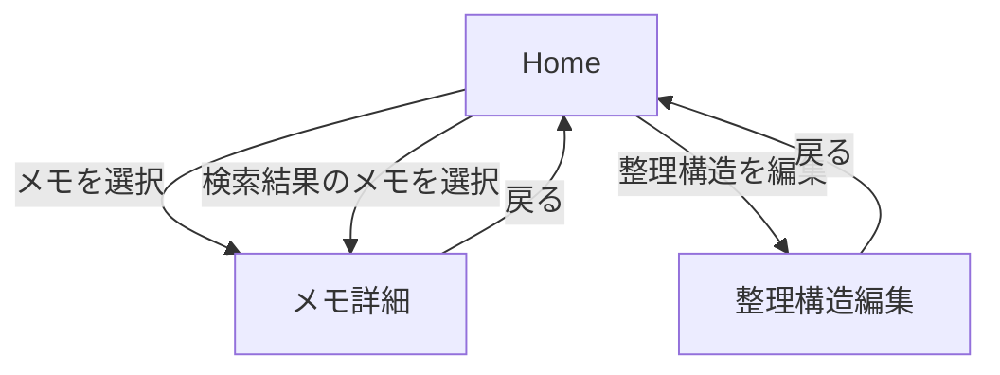

# Phase 5 画面基本設計

## 1. 文書の目的

本書は、「放り込むだけAI整理ツール」のMVPで提供する画面、表示項目、操作、状態別表示およびAPIとの対応を定義する。

本アプリの中心体験は、ユーザーが整理方法を事前設定せずにメモを保存し、AIが作った整理結果を確認・必要な場合だけ修正できることである。

## 2. 共通UI方針

- スマートフォンを優先し、PCでも使用できるレスポンシブ表示とする。
- メモ入力時に整理先やタグの指定を要求しない。
- 保存成功とAI整理成功を別の状態として表示する。
- AIによる推測とユーザーが確定した内容を区別する。
- 原文は常に確認できるようにする。
- AI結果が意図と違う場合、その場で最小限の修正を行えるようにする。
- エラー時は理由と次に行える操作を示す。
- 作成・名前変更等の軽い操作は、インライン編集または小さなモーダルで完結させる。

## 3. 画面一覧

| 画面 | 主な役割 |
|---|---|
| Home | メモ入力、保存済みメモと整理構造の確認、検索、AI処理状態の把握 |
| メモ詳細 | 原文・整理先の確認、編集、再整理、提案判断、削除 |
| 整理構造編集 | organizationツリーの作成、名前変更、移動、削除 |

認証画面は要件上必要だが、本書ではPhase 5で具体的にレビューした上記3画面を主対象とする。ログイン・登録・パスワード変更／リセットの詳細UIは後続設計で補完する。

## 4. 画面遷移概要



## 5. Home

### 5.1 目的

- 思いついた内容をすぐ保存する。
- AI整理を待たずに次の操作へ進める。
- 保存したメモとAI処理状態を確認する。
- organization別にメモを探す。
- キーワードから保存済みメモを検索する。

### 5.2 主な表示要素

- メモ検索欄
- 検索実行操作
- 検索結果一覧
- メモ原文入力欄
- 保存ボタン
- organizationツリーまたはカテゴリ一覧
- 選択中organizationのメモ一覧
- 未整理・処理中・失敗状態が分かる表示
- 整理構造編集画面への導線

### 5.3 メモ入力

| 状態 | 表示・操作 |
|---|---|
| 初期 | 原文を入力できる |
| 入力なし／空白のみ | 保存不可。理由を表示する |
| 保存中 | 二重送信を防ぎ、処理中であることを示す |
| 保存成功 | 入力を完了扱いとし、AI整理中であることを別に示す |
| 保存失敗 | 入力内容を失わず、再試行できるようにする |

保存時にorganization選択は要求しない。

### 5.4 AI処理状態

| 状態 | 画面表示の考え方 |
|---|---|
| `PROCESSING` | AI整理中。ローディング表示 |
| `COMPLETED` | 初回結果または未判断再整理提案を画面へ反映 |
| `FAILED` | 失敗を表示し、条件を満たす場合は再実行への導線を出す |
| `CANCELLED` | 削除済み・ユーザー確定済み等により反映不要となった処理。通常は処理中表示を解除して最新状態を再取得する |

残留判定時間（初期値2分）を超えた `PROCESSING` は、状態取得APIからタイムアウト扱いとして返される。

- GETによる状態取得だけではDB状態を変更しない。
- タイムアウト扱いの`PROCESSING`は「現在処理中」の件数から除外する。
- タイムアウト扱いの場合は、条件を満たす初回整理再試行または再整理を操作可能にする。
- 実際の `PROCESSING → FAILED` 回復は、再試行／再整理開始時にサーバー側で行う。

一覧を開いている間にAI整理が完了した場合は結果を反映する。ただし複数メモの完了時にポップアップを連続表示せず、一覧内の状態更新を中心とする。

`CURRENT`が存在せず、有効なINITIAL PROCESSINGがないメモには、過去のFAILED履歴の有無にかかわらず「初回整理を再試行」を表示する。`CURRENT`が存在するメモでは再整理の開始条件に従って「再整理」を表示する。

### 5.5 メモ検索

#### 基本表示

Home上に検索欄を配置し、別の検索専用画面は設けない。

検索結果はHome内の一覧として表示し、結果のメモを選択すると既存のメモ詳細画面へ遷移する。

#### 検索対象

- タイトル
- 原文
- 現在正式に採用されている`CURRENT`のorganization名

次は検索対象外とする。

- `AI_SUGGESTED`
- 未判断の再整理提案（`ai_processes.proposed_result`）

#### 表示する検索結果

検索結果一覧では、MVPとして次の情報を表示候補とする。

- タイトル
- 原文の一部
- `CURRENT`のorganization
- 作成日時または更新日時

厳密な表示項目・文字数・並び順はPhase 6で決める。

#### 入力状態

| 状態 | 表示・操作 |
|---|---|
| 有効なキーワード | 検索を実行し、Home内に結果一覧を表示する |
| 検索結果0件 | 「検索結果はありません」等を表示する |
| 空文字 | 検索を実行せず、通常のHome表示を維持する |
| スペースのみ | trim後に空として扱い、検索を実行せず通常のHome表示を維持する |

空文字またはスペースのみで検索操作を行った場合は、検索欄付近に「検索キーワードを入力してください」等の入力エラーをインライン表示する。

有効な検索キーワードが入力された場合は、当該入力エラー表示を解除する。

#### その他

- 英字の大文字・小文字は区別しない。
- 部分一致検索とする。
- 同じメモがタイトル・原文・`CURRENT`の複数箇所で一致しても、検索結果には1件だけ表示する。
- Organizationによる追加絞り込み、日付絞り込みはMVPでは追加しない。

### 5.6 API対応

| 操作 | API |
|---|---|
| メモ検索 | `GET /memos/search?q={keyword}` |
| メモ保存 | `POST /memos` |
| メモ詳細を開く | `GET /memos/{id}` |
| organization別表示 | organizationツリー取得およびメモ一覧取得API |
| 初回AI整理失敗後の再実行 | `POST /memos/{id}/organize` |

初回整理再試行は`process_type = INITIAL`として扱い、成功時に`AI_SUGGESTED`と`CURRENT`を作成する。未判断再整理提案（`proposed_result`）は作成しない。

## 6. メモ詳細

### 6.1 目的

- 保存した原文と現在の整理状態を確認する。
- タイトル・原文・整理先を必要な範囲で変更する。
- AI再整理を依頼し、提案を採用するか判断する。
- 不要なメモを削除する。

### 6.2 表示項目

- タイトル
- 原文
- 作成日時・更新日時
- 現在の整理先（`CURRENT`）
- 初回AI提案（必要な場合）
- 未判断のAI再整理提案
- 判断待ち件数（最大2件）
- 現在の判断対象（FIFO先頭）
- AI処理状態・有効な処理中件数・タイムアウト扱い
- AI整理回数（成功・失敗・CANCELLEDを含む全`ai_processes`件数）
- 整理結果が現在の原文に対して古い可能性を示すoutdated表示

### 6.3 編集

#### タイトル

- AI処理中でも編集できる。
- 保存結果をその場で確認できる。

#### 原文

- AI処理中も編集できる。
- 更新時はサーバー側でmemo悲観ロックを取得する。
- ロック取得がタイムアウトした場合は409として、時間を置いて再操作できることを案内する。
- AI Serviceへ送信した本文と現在本文が異なっていても、MVPでは返却AI結果を自動無効化しない。
- 原文編集後も現在の整理先・未判断提案を自動削除せず、`content_updated_at` を基準にoutdated判定を行い、必要に応じて再整理を促す。
  - 未判断REORGANIZE提案は対応する `ai_processes.created_at` と比較する。
  - CURRENTは `ai_process_id` が非NULLなら対応するAI処理の `ai_processes.created_at` と比較する（INITIAL由来／REORGANIZE提案をそのまま採用）。
  - CURRENTの `ai_process_id` がNULLならCURRENT行の `created_at` と比較する（通常の手動変更／「変更して使う」）。
  - `proposed_at` はFIFO専用でoutdated判定には使用しない。
- 未判断提案表示中の原文編集にも追加の画面ロックは設けない。

#### 整理先

- organizationツリーから複数選択できる。
- 変更後の選択内容を`CURRENT`として保存する。
- 通常の整理先変更もmemo悲観ロックの対象とし、3秒以内に取得できない場合は `409 / LOCK_TIMEOUT` とする。
- 画面遷移を増やさず、詳細画面内のモーダル等で完結させる。

### 6.4 AI再整理

再整理ボタンの可否は、DB上の`PROCESSING`件数だけではなく、サーバーから返される有効な処理中件数・タイムアウト判定・未判断提案件数を基準とする。

| 状態 | 操作 |
|---|---|
| `CURRENT`なし、有効なINITIAL `PROCESSING`なし | 「再整理」ではなく「初回整理を再試行」を表示。FAILED履歴は必須としない |
| `CURRENT`なし、非タイムアウトINITIAL `PROCESSING` | 完了を待つ。再試行・再整理は不可 |
| `CURRENT`なし、タイムアウト扱いINITIAL `PROCESSING` | 「初回整理を再試行」を表示。開始時にサーバー側で残留処理を回復 |
| `CURRENT`あり、非タイムアウトINITIAL `PROCESSING`あり | INITIALの完了またはタイムアウト待ち。再整理は不可 |
| `CURRENT`あり、タイムアウト扱いINITIAL `PROCESSING`あり | 再整理を開始可能。開始時にサーバー側で残留INITIALを回復 |
| `CURRENT`あり、非タイムアウトREORGANIZE `PROCESSING`あり | 新しい再整理は不可 |
| `CURRENT`あり、REORGANIZEアクティブ総数2件 | 新しい再整理は不可。理由を表示 |
| `CURRENT`あり、未判断提案1件・PROCESSINGなし | 2件目の再整理を開始可能 |
| `CURRENT`あり、タイムアウト扱いREORGANIZE `PROCESSING`のみ | 再整理を再度開始可能。開始時にサーバー側で残留処理を回復 |

- REORGANIZEの `PROCESSING` は同一memoにつき最大1件。
- 未判断提案を含むREORGANIZEアクティブ総数は最大2件。
- タイムアウト扱いのPROCESSINGはアクティブ件数から除外する。
- 再整理ボタンは送信直後に連打できない状態へ切り替える。
- 自動リトライは行わない。
- AI結果は`CURRENT`へ自動反映しない。

### 6.5 未判断AI再整理提案の表示と操作

未判断提案は最大2件まで保持でき、`proposed_at ASC, id ASC` のFIFO順で扱う。

画面では、

```text
判断待ち 2件
1件目：現在の判断対象 → 内容表示＋操作可能
2件目：待機中 → 判断操作は行えない
```

のように、件数と判断順序が分かるようにする。

各提案にはAPIから受け取った `aiProcessId` を内部的に保持する。ユーザーへIDそのものを表示する必要はない。

現在の判断対象について、現在の整理先とAI変更候補を比較できるようにする。

| 操作 | 結果 |
|---|---|
| 採用する | 表示済み`aiProcessId`を送信し、提案内容で`CURRENT`を置換する |
| 変更して使う | 表示済み`aiProcessId`と編集内容を送信し、新しい`CURRENT`として保存する |
| 使わない | 表示済み`aiProcessId`を送信し、対象`proposed_result`だけを消費して`CURRENT`を維持する |

- サーバー側で、送信した`aiProcessId`が現在の判断対象か再検証する。
- `DECISION_TARGET_MISMATCH`の場合は最新状態を再取得して表示を更新する。
- 提案採用時に参照organizationが削除済み等でそのまま反映できない場合は409とし、提案自体は残す。
- 既存organizationを含む提案の比較表示では、保存時の名称・パスを固定表示せず、`organizationId` から現在のorganizationパスを取得して表示する。名前変更・移動だけでは提案を無効化しない。
- 上記409時の具体的なユーザー向け表示文言は別途検討する。
- 「使わない」は提案内容が古くても実行可能とする。
- 「変更して使う」では、旧`CURRENT`の削除を漏らさない。
- `AI_SUGGESTED`は初回整理の固定記録として維持する。
- 1件目を消費したら状態を再取得し、次の提案を新しい判断対象として表示する。

### 6.6 メモ削除

- 画面下部に削除操作を配置する。
- 誤操作防止の確認を行う。
- AI処理中でも削除できる。
- 削除完了後はHomeへ戻し、AI完了結果を表示しない。

### 6.7 API対応

| 操作 | API |
|---|---|
| 詳細取得 | `GET /memos/{id}` |
| 整理先取得 | `GET /memos/{id}/organizations` |
| タイトル／原文更新 | `PATCH /memos/{id}` |
| 整理先変更 | `PUT /memos/{id}/organizations` |
| 再整理 | `POST /memos/{id}/reorganize` |
| 提案を採用 | `POST /memos/{id}/organizations/accept`（`aiProcessId`指定） |
| 提案を変更して使用 | `PUT /memos/{id}/organizations`（`aiProcessId`指定） |
| 提案を使わない | AI提案破棄専用API（`aiProcessId`指定、URIは後続API詳細設計で確定） |
| メモ削除 | `DELETE /memos/{id}` |

## 7. 整理構造編集

### 7.1 目的

organizationの全体像をツリーで確認しながら、その場で作成・名前変更・移動・削除する。

### 7.2 表示・操作

- organizationツリー
- organization追加
- `…`メニュー
  - 名前変更
  - 移動
  - 削除
- インライン編集または小さなモーダル

### 7.3 作成・名前変更

- 対象の親を把握できる状態で作成する。
- 名称をその場で編集・保存できる。
- 入力不正時は対象項目の近くに理由を表示する。

### 7.4 移動

- ユーザーが「移動先の親organizationを選ぶ」操作として理解できる表現にする。
- 自分自身と自分の子孫は、明らかに無効な移動先として候補から除外する。
- 移動後の位置が分かるようツリーを更新する。

### 7.5 削除

- 削除前に対象を確認する。
- 削除不可の場合、「削除できません」だけで終了しない。
- ユーザー向けに削除できない理由を示す。
- 残っている要素を解消するための操作へ、リンクまたはボタンで直接進める。
- 別画面を何度も遷移せず、モーダルまたはインライン操作を基本とする。

削除不可理由の内部的な判定条件とユーザー向け文言は分離し、技術用語をそのまま表示しない。

### 7.6 API対応

| 操作 | API責務 |
|---|---|
| ツリー表示 | organizationツリー取得 |
| 作成 | organization作成 |
| 名前変更 | organization更新 |
| 移動 | 親organization変更 |
| 削除 | organization削除、削除不可理由取得 |

最終的なURIは`api-design.md`のPhase 6申し送りと合わせて確定する。

## 8. 共通エラー・空状態

- データがない場合は、次にできる操作を示す空状態を表示する。
- 検索結果が0件の場合は検索失敗とはせず、「検索結果はありません」等の空状態を表示する。
- 検索キーワードが空文字または空白のみの場合は検索せず、通常Homeを維持し、検索欄付近に理由をインライン表示する。
- 通信失敗時は入力内容や編集内容を可能な限り保持する。
- `409 Conflict`ではエラーコードに応じて扱いを分ける。
  - `DECISION_TARGET_MISMATCH`：状態を再取得し、判断対象を更新する。
  - `NO_PENDING_PROPOSAL`：未判断提案表示を再取得する。
  - `LOCK_TIMEOUT`：処理が競合した旨と再操作を案内する。
  - `ACTIVE_LIMIT_EXCEEDED`：現在の処理中・判断待ち件数を示し、新規再整理できない理由を案内する。
  - `PROPOSAL_STALE`：提案を消費せず保持し、そのまま採用できないことを示す。具体文言は画面詳細設計で確定する。
  - `ORGANIZATION_CONFLICT`：整理構造を再取得し、同名等の競合として案内する。
  - `PROCESS_STATE_CONFLICT`：最新状態を再取得し、現在実行可能な操作を案内する。
- `404 Not Found`では削除済み等を考慮し、Homeへ戻る導線を出す。
- システム内部のエラー詳細やAI Serviceの生エラーは利用者へ表示しない。

## 9. アクセシビリティ・レスポンシブ方針

- ボタンは文言またはアクセシブルなラベルで目的を識別できるようにする。
- 色だけで状態を区別しない。
- キーボード操作とフォーカス移動を考慮する。
- スマートフォンでは主要操作を1列中心に配置する。
- PCではツリーと一覧・詳細を同時に見やすくする余地を残す。

## 10. Phase 6への申し送り

- 各画面の詳細レイアウト、コンポーネント分割、ブレークポイント
- ローディング、トースト、インラインメッセージの使い分け
- Homeのメモ一覧取得・更新方式
- Home検索結果の詳細表示項目、並び順、検索解除時の状態復元
- AI処理完了を検知するポーリング等の具体方式
- 「判断待ち N件」「待機中提案」の具体レイアウト
- タイムアウト扱いPROCESSINGの具体的な表示文言
- 古くなった提案を採用できない409時の具体文言
- outdated表示条件と文言
- organization削除不可理由ごとの具体的な誘導
- 認証関連画面の詳細設計

## 11. 最終レビュー確認事項

Phase 5のDB／API／画面間で、状態、競合条件、削除、整理先更新および検索対象に矛盾がないことを確認する。

### Phase 6開始後の補足

Phase 6のバックエンド構成詳細設計中に、MVP対象の検索機能についてPhase 5画面設計で具体化が不足していることを確認した。

PO判断により、Homeに検索欄を配置し、タイトル・原文・`CURRENT`のorganization名を部分一致で検索する。空文字／空白のみでは検索せず通常Homeを維持し、検索欄付近に入力理由をインライン表示する方針をPhase 5補足として追加した。